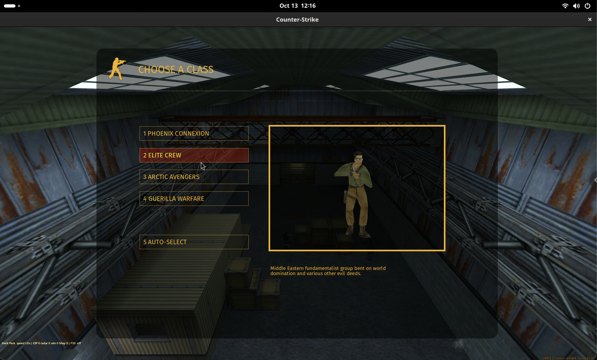

# Counter Strike Hacking
Brought to you by The Hack Pack.

 

## Getting Started

We are playing Counter Strike 1.6. This is an oldver version of the famous Counter Strike: Global Offensive.
If you want to run the server yourself, follow the [server/README.md](server/README.md)

### Dowload The Client 
If you are student, download the modified client below to start. The password will be given in-person:
https://drive.proton.me/urls/M7E7QEVZ78#fmKicUj0FtAc

It is reccomend you use the Linux version if you plan to hack, else you can use any OS.

### Join The Server
You can find the live server at `cs.mahaloz.re`. To join, once you start the game, go to:
`Play CS -> Play Online -> Add IP`. 

Select `Xash3D 49` in the top bar, and add `cs.mahaloz.re`.


## Hacking
Instead of using the default client, you can use our modified hacked client.
Clone this repo down and do the following:
```bash
python3 install.py ../CS16Client-Linux-x86_64/ # path to the client folder
python3 launch.py ../CS16Client-Linux-x86_64 --server cs.mahaloz.re:27015 --name YourName --debug
```

This will start you up in the hacked client, and make it easier to debug your own client.


